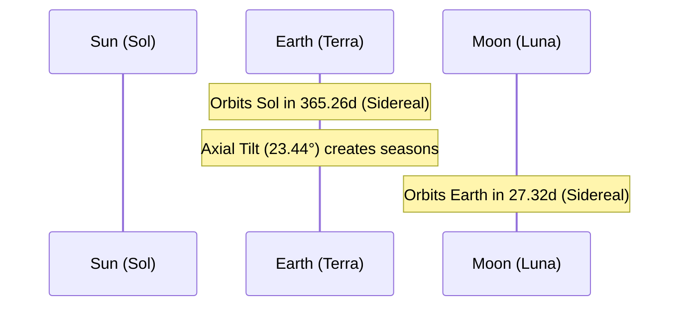

# Celestial Profile: Earth (Terra)

This document provides the scientific classification, physical characteristics, and orbital mechanics of **Earth**, the third planet from the Sun. It serves as a baseline technical reference for planetary metrics, magnetospheric protections, and orbital references.

---

## 1. Classification & Identification

| Parameter | Scientific Value / Designation |
| :--- | :--- |
| **Official Name** | Earth (Terra / Gaia) |
| **System** | Sol (Solar System) |
| **Primary Body** | Sol (Sun) |
| **Classification** | Habitable Terrestrial Planet |
| **Status** | Active Biosphere & Hydrosphere |

---

## 2. Physical Characteristics

Earth is the densest major planet in the Solar System and the largest of the four terrestrial planets. It is the only known planetary body with active plate tectonics and liquid surface water.

*   **Mean Radius ($R_E$)**: $6,371.0 \text{ km}$ ($1.0 \text{ Earth radius}$)
*   **Equatorial Circumference**: $40,075 \text{ km}$
*   **Mass ($M_E$)**: $5.9722 \times 10^{24} \text{ kg}$ ($1.0 \text{ Earth mass}$)
*   **Mean Density**: $5.515 \text{ g/cm}^3$ (densest body in the Solar System; consists of a solid iron-nickel inner core, liquid outer core, silicate mantle, and crust)
*   **Surface Gravity ($g_E$)**: $9.80665 \text{ m/s}^2$ ($1.0 \text{ g}$)
*   **Escape Velocity ($v_e$)**: $11.186 \text{ km/s}$ ($40,270 \text{ km/h}$)
*   **Atmosphere**: Rich nitrogen-oxygen mix (composition: $78.08\%$ Nitrogen, $20.95\%$ Oxygen, $0.93\%$ Argon, $0.04\%$ Carbon Dioxide; surface pressure is $1.013 \text{ bar}$).

---

## 3. Orbital Mechanics & Cycles

Earth's orbit is moderately circular, acting as the reference plane (the Ecliptic) for all other solar orbital measurements.

### A. Orbit Parameters
*   **Semi-major Axis ($a$)**: $149,598,023 \text{ km}$ ($1.000 \text{ AU}$)
*   **Perihelion (Closest Approach)**: $147,095,000 \text{ km}$ ($0.983 \text{ AU}$)
*   **Aphelion (Furthest Point)**: $152,100,000 \text{ km}$ ($1.017 \text{ AU}$)
*   **Orbital Eccentricity ($e$)**: $0.0167$
*   **Orbital Inclination ($i$)**: $0.0^\circ$ (by definition, defines the ecliptic plane).

### B. Rotational Mechanics
*   **Sidereal Day ($T_{sidereal}$)**: The time required for Earth to rotate once on its axis relative to background stars.
    $$T_{sidereal} = 23\text{ hours } 56\text{ minutes } 4.09\text{ seconds} \quad (0.99727 \text{ days})$$
*   **Solar Day ($T_{solar}$)**: The time elapsed from solar noon to solar noon.
    $$T_{solar} = 24\text{ hours} \quad (1.0 \text{ day})$$
*   **Axial Tilt (Obliquity)**: $23.44^\circ$
    *   *Effect*: Responsible for the seasonal variations (Solstices and Equinoxes) as different hemispheres are inclined toward Sol.

---

## 4. Magnetosphere & Geomagnetic Safeguards

*   **Geodynamo**: Liquid outer core convection, driven by thermal gradients and Earth's rotation, generates a powerful dipole magnetic field.
*   **Van Allen Radiation Belts**: The magnetic field traps solar wind particles, forming two toroidal radiation zones that shield the atmosphere and surface from high-energy cosmic rays.
*   **Tidal Drag**: Luna's gravitational pull creates tidal bulges on Earth. Because Earth rotates faster than Luna orbits, these bulges run slightly ahead of the Earth-Moon axis, transferring angular momentum to Luna. This slows Earth's rotation by $\approx 2.3 \text{ milliseconds per century}$ and causes Luna's orbit to expand by $\approx 3.78 \text{ cm/year}$.
