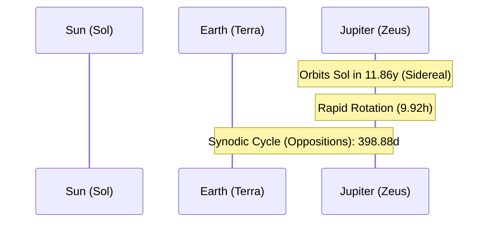

# Celestial Profile: Jupiter (Zeus)

This document provides the scientific classification, physical characteristics, and orbital mechanics of **Jupiter**, the fifth planet from the Sun. It serves as a technical reference for planetary mass scaling, rotational velocity, and strong magnetospheres.

---

## 1. Classification & Identification

| Parameter | Scientific Value / Designation |
| :--- | :--- |
| **Official Name** | Jupiter |
| **System** | Sol (Solar System) |
| **Primary Body** | Sol (Sun) |
| **Classification** | Gas Giant (Jovian Planet) |
| **Natural Satellites** | 95 confirmed (e.g., Io, Europa, Ganymede, Callisto) |

---

## 2. Physical Characteristics

Jupiter is the largest planet in the Solar System, containing more than twice the mass of all other planets combined. It is characterized by its banded cloud layers, the Great Red Spot (a persistent anticyclonic storm), and its vast hydrogen-helium mantle.

*   **Mean Radius ($R_J$)**: $69,911 \text{ km}$ ($10.97 \text{ Earth radii}$)
*   **Equatorial Circumference**: $439,264 \text{ km}$
*   **Mass ($M_J$)**: $1.8982 \times 10^{27} \text{ kg}$ ($317.8 \text{ Earth masses}$)
*   **Mean Density**: $1.326 \text{ g/cm}^3$ (low density; composed mainly of hydrogen and helium in gaseous, liquid, and metallic phases)
*   **Surface Gravity (1 bar level)**: $24.79 \text{ m/s}^2$ ($2.528 \text{ g}$)
*   **Escape Velocity ($v_e$)**: $59.5 \text{ km/s}$ ($214,200 \text{ km/h}$)
*   **Atmosphere**: Deep and volatile (composition: $89.8\%$ Hydrogen, $10.2\%$ Helium, with traces of methane, ammonia, and water vapor).

---

## 3. Orbital Mechanics & Cycles

Jupiter orbits at a vast distance from the Sun, acting as a gravitational anchor for the outer Solar System.

### A. Orbit Parameters
*   **Semi-major Axis ($a$)**: $778,547,200 \text{ km}$ ($5.203 \text{ AU}$)
*   **Perihelion (Closest Approach)**: $740,520,000 \text{ km}$ ($4.950 \text{ AU}$)
*   **Aphelion (Furthest Point)**: $816,570,000 \text{ km}$ ($5.459 \text{ AU}$)
*   **Orbital Eccentricity ($e$)**: $0.0489$
*   **Orbital Inclination ($i$)**: $1.303^\circ$ relative to the ecliptic plane.

### B. Rotational Mechanics (Rapid Rotation)
*   **Sidereal Rotation Period ($T_{rot}$)**: Jupiter has the fastest rotation rate of any major planet. It exhibits differential rotation, spinning faster at the equator (System I) than at higher latitudes (System II). The core and magnetosphere rotate in:
    $$T_{rot} = 9\text{ hours } 55\text{ minutes } 30\text{ seconds} \quad (0.4135 \text{ days})$$
    *   *Effect*: This rapid spin causes a highly pronounced equatorial bulge, flattening the poles (oblate spheroid shape; polar radius is $6,420\text{ km}$ shorter than equatorial).
*   **Axial Tilt (Obliquity)**: $3.13^\circ$
    *   *Effect*: Virtually no seasonal temperature variations compared to Earth or Mars.

---

## 4. Earth-Jupiter Synodic Cycle

Because Jupiter's orbital path is vast and slow, Earth passes between Jupiter and the Sun approximately once every year.

*   **Synodic Period ($T_y$)**: The interval between successive oppositions.
    $$T_y = 398.88 \text{ days}$$

During **Opposition** ($180^\circ$ elongation from the Sun), Jupiter reaches its highest point in the night sky at midnight and is at its closest distance to Earth.

---

## 5. Magnetospheric & Tidal Dynamics

*   **Powerful Magnetosphere**: Jupiter's magnetic field is generated by electric currents in its rotating, convective mantle of liquid metallic hydrogen. Its magnetic moment is $18,000$ times larger than Earth's, producing a magnetosphere that extends up to $7 \text{ million km}$ toward the Sun and forms a tail reaching the orbit of Saturn.
*   **Galilean Satellites**: The four largest moons (Io, Europa, Ganymede, Callisto) are locked in orbital resonances (Ganymede, Europa, and Io are in a $1:2:4$ Laplace resonance). This resonance drives strong tidal heating, maintaining active volcanism on Io and a liquid sub-surface ocean beneath Europa's icy crust.
