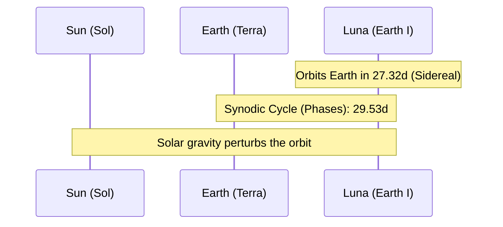

# Celestial Profile: Luna (Earth I)

This document provides the scientific classification, physical characteristics, and orbital mechanics of Earth's natural satellite, **Luna** (commonly referred to as the Moon). It serves as a technical reference for celestial and orbital calculations.

---

## 1. Classification & Identification

| Parameter | Scientific Value / Designation |
| :--- | :--- |
| **Official Name** | Luna (Earth I) |
| **System** | Sol (Solar System) |
| **Primary Body** | Earth (Terra) |
| **Classification** | Major Natural Satellite / Terrestrial-type Planetary Body |
| **Status** | Tidally Locked |

---

## 2. Physical Characteristics

Luna is the fifth-largest natural satellite in the Solar System. Its physical profile is characterized by low gravity, a lack of a significant atmosphere, and a highly cratered silicate crust.

*   **Mean Radius ($R_L$)**: $1,737.4 \text{ km}$ ($0.2727 \text{ Earth radii}$)
*   **Equatorial Circumference**: $10,921 \text{ km}$
*   **Mass ($M_L$)**: $7.342 \times 10^{22} \text{ kg}$ ($0.0123 \text{ Earth masses}$)
*   **Mean Density**: $3.344 \text{ g/cm}^3$ (composed primarily of silicate rock with a small metallic core)
*   **Surface Gravity ($g_L$)**: $1.62 \text{ m/s}^2$ ($0.166 \text{ g}$)
*   **Escape Velocity ($v_e$)**: $2.38 \text{ km/s}$ ($8,568 \text{ km/h}$)
*   **Atmosphere**: Extremely thin exosphere (composed of helium, neon, hydrogen, and argon; total pressure $\approx 3 \times 10^{-15} \text{ bar}$)

---

## 3. Orbital Mechanics & Cycles

Luna orbits Earth in a prograde direction relative to the Earth's North Pole. The orbital path is elliptical and perturbed by the gravitational influence of the Sun.

### A. Orbit Parameters
*   **Semi-major Axis ($a$)**: $384,399 \text{ km}$ ($0.00257 \text{ AU}$)
*   **Perigee (Closest Approach)**: $362,600 \text{ km}$
*   **Apogee (Furthest Point)**: $405,400 \text{ km}$
*   **Orbital Eccentricity ($e$)**: $0.0549$
*   **Orbital Inclination ($i$)**: $5.145^\circ$ relative to the ecliptic plane (the plane of Earth's orbit around the Sun). 

> [!NOTE]
> Because Luna's orbital plane is inclined relative to the ecliptic, rather than the Earth's equatorial plane, the intersection of the two planes regresses westward over an $18.6$-year cycle (nodal regression).

### B. Sidereal vs. Synodic Periods
1.  **Sidereal Month ($T_s$)**: The time required for Luna to complete one full orbit around Earth relative to the background stars.
    $$T_s = 27.321661 \text{ days} \quad (27\text{d } 7\text{h } 43\text{m } 11.5\text{s})$$
2.  **Synodic Month ($T_y$)**: The time required for Luna to return to the same position relative to the Sun (e.g., from one New Moon to the next). This is the cycle that dictates lunar phases and illumination.
    $$T_y = 29.530589 \text{ days} \quad (29\text{d } 12\text{h } 44\text{m } 2.9\text{s})$$

> [!TIP]
> The synodic month is longer than the sidereal month because as Luna orbits Earth, Earth also moves along its orbit around the Sun. Luna must travel an additional $26.9^\circ$ to realign with the Earth-Sun vector.

---

## 4. The Synodic Phase Cycle

The synodic cycle is characterized by the Moon's phase fraction, which corresponds to the geocentric elongation angle ($\alpha$) between the Moon and the Sun.

$$\alpha = \theta_{\text{Moon}} - \theta_{\text{Sun}}$$

The phase fraction or illumination scale ($I$) is defined geometrically as:
$$I = \frac{1 - \cos(\alpha)}{2}$$
*   $I = 0.0$ at New Moon ($\alpha = 0^\circ$).
*   $I = 1.0$ at Full Moon ($\alpha = 180^\circ$).

| Phase Index | Phase Name | Lunar Age Range (Days) | Geocentric Elongation ($\alpha$) |
| :---: | :--- | :--- | :---: |
| **1** | New Moon | $0.0 \le A < 1.0$ & $28.53 < A \le 29.53$ | $0^\circ$ |
| **2** | Waxing Crescent | $1.0 \le A < 6.38$ | $0^\circ < \alpha < 90^\circ$ |
| **3** | First Quarter | $6.38 \le A < 8.38$ | $90^\circ$ |
| **4** | Waxing Gibbous | $8.38 \le A < 13.77$ | $90^\circ < \alpha < 180^\circ$ |
| **5** | Full Moon | $13.77 \le A < 15.77$ | $180^\circ$ |
| **6** | Waning Gibbous | $15.77 \le A < 21.15$ | $180^\circ < \alpha < 270^\circ$ |
| **7** | Third Quarter | $21.15 \le A < 23.15$ | $270^\circ$ |
| **8** | Waning Crescent | $23.15 \le A \le 28.53$ | $270^\circ < \alpha < 360^\circ$ |

---

## 5. Gravitational & Tidal Dynamics

*   **Tidal Locking**: The gravitational gradient across Luna's diameter has decelerated its spin cycle to match its orbital period. As a result, its rotational period matches its sidereal period ($27.32$ days), presenting only the near side to Earth observers.
*   **Libration**: Slight oscillations (libration in latitude, longitude, and diurnal libration) allow observers on Earth to view approximately $59\%$ of Luna's surface over the course of an orbital cycle.
*   **Barycenter**: The Earth-Moon system orbits around a shared center of mass (the barycenter), which lies approximately $4,671\text{ km}$ from the center of Earth (about $75\%$ of the Earth's radius).

---

## 6. Code References

The mathematical properties of Luna's synodic cycle are defined in the following code locations:
*   [WaveMath.LUNAR_MONTH_DAYS](file:///c:/Users/brent/Antigravity/GENPOX/pox-android/app/src/main/java/com/example/genpox/data/WaveMath.kt#L15): Defines the synodic month constant as $29.53059$ days.
*   [WaveMath.REFERENCE_NEW_MOON_MS](file:///c:/Users/brent/Antigravity/GENPOX/pox-android/app/src/main/java/com/example/genpox/data/WaveMath.kt#L18-L23): Sets the epoch seed for calculation using the UTC date `2026-05-17T01:54:00Z`.
*   [WaveMath.getDailyWaveConfig](file:///c:/Users/brent/Antigravity/GENPOX/pox-android/app/src/main/java/com/example/genpox/data/WaveMath.kt#L68-L145): Resolves the lunar age and maps it to the eight synodic phases.
