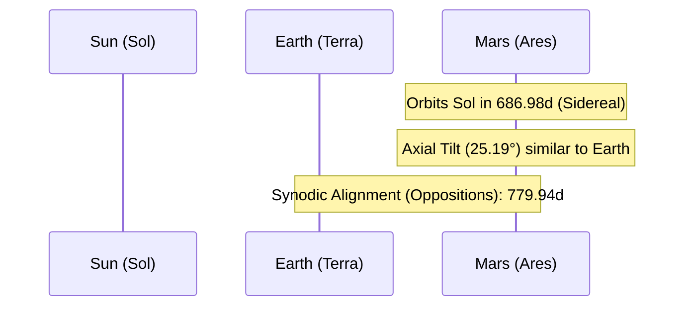

# Celestial Profile: Mars (Ares)

This document provides the scientific classification, physical characteristics, and orbital mechanics of **Mars**, the fourth planet from the Sun. It serves as a technical reference for thin atmospheres, surface gravity shifts, and synodic alignments.

---

## 1. Classification & Identification

| Parameter | Scientific Value / Designation |
| :--- | :--- |
| **Official Name** | Mars |
| **System** | Sol (Solar System) |
| **Primary Body** | Sol (Sun) |
| **Classification** | Outer Terrestrial Planet |
| **Natural Satellites** | Phobos, Deimos |

---

## 2. Physical Characteristics

Mars is a cold, dry, desert world with half the diameter of Earth. It is known for its iron oxide crust, which gives it a reddish hue, and its towering shield volcanoes and deep canyon systems.

*   **Mean Radius ($R_{Mars}$)**: $3,389.5 \text{ km}$ ($0.532 \text{ Earth radii}$)
*   **Equatorial Circumference**: $21,344 \text{ km}$
*   **Mass ($M_{Mars}$)**: $6.4171 \times 10^{23} \text{ kg}$ ($0.107 \text{ Earth masses}$)
*   **Mean Density**: $3.933 \text{ g/cm}^3$ (less dense than Earth; indicates a smaller core relative to total volume)
*   **Surface Gravity ($g_{Mars}$)**: $3.72 \text{ m/s}^2$ ($0.379 \text{ g}$)
*   **Escape Velocity ($v_e$)**: $5.027 \text{ km/s}$ ($18,100 \text{ km/h}$)
*   **Atmosphere**: Extremely thin (composition: $95.32\%$ Carbon Dioxide, $1.9\%$ Nitrogen, $1.9\%$ Argon; surface pressure is $0.006 \text{ bar}$, less than $1\%$ of Earth's atmospheric density).

---

## 3. Orbital Mechanics & Cycles

Mars has a highly eccentric orbit compared to Earth, causing its distance from the Sun to vary significantly throughout its year.



### A. Orbit Parameters
*   **Semi-major Axis ($a$)**: $227,939,200 \text{ km}$ ($1.5237 \text{ AU}$)
*   **Perihelion (Closest Approach)**: $206,620,000 \text{ km}$ ($1.381 \text{ AU}$)
*   **Aphelion (Furthest Point)**: $249,230,000 \text{ km}$ ($1.666 \text{ AU}$)
*   **Orbital Eccentricity ($e$)**: $0.0934$
*   **Orbital Inclination ($i$)**: $1.850^\circ$ relative to the ecliptic plane.

### B. Rotational Mechanics
*   **Sidereal Rotation Period ($T_{rot}$)**: Mars has a rotation rate very close to Earth's:
    $$T_{rot} = 24\text{ hours } 37\text{ minutes } 22.6\text{ seconds} \quad (1.02595 \text{ days})$$
    *   *Note*: A Martian solar day is referred to as a **Sol**.
*   **Axial Tilt (Obliquity)**: $25.19^\circ$
    *   *Effect*: Generates seasonal shifts similar to Earth's, though they last roughly twice as long due to its longer orbital year.

---

## 4. Earth-Mars Synodic Cycle (oppositions)

Because Mars is an outer planet, its orbital speed is slower than Earth's. As a result, Earth periodically catches up to and passes Mars in its orbit.

*   **Synodic Period ($T_y$)**: The time between successive alignments where Earth lies directly between the Sun and Mars. This is the longest synodic period among the major planets.
    $$T_y = 779.94 \text{ days} \quad (2.135 \text{ years})$$

```
[Conjunction] ──> [Quadrature (Western)] ──> [Opposition] ──> [Quadrature (Eastern)]
  (Max Distance)         (90° Elongation)        (Closest Approach)       (90° Elongation)
```

| Configuration | Description | Elongation Angle | Visibility / Size |
| :--- | :--- | :---: | :--- |
| **Conjunction** | Mars is on the opposite side of the Sun from Earth. | $0^\circ$ | Invisible; furthest distance. |
| **Western Quadrature** | Mars is $90^\circ$ west of the Sun in Earth's sky. | $90^\circ$ | Visible at midnight; half illuminated. |
| **Opposition** | Earth passes directly between the Sun and Mars. | $180^\circ$ | Best visibility; brightest and closest. |
| **Eastern Quadrature** | Mars is $90^\circ$ east of the Sun in Earth's sky. | $90^\circ$ | Visible in early evening; half illuminated. |
