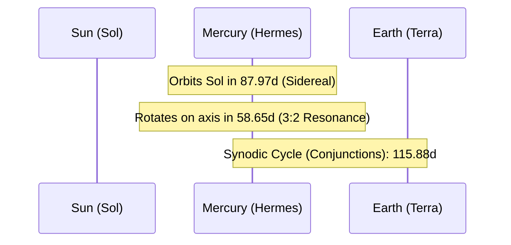

# Celestial Profile: Mercury (Hermes)

This document provides the scientific classification, physical characteristics, and orbital mechanics of **Mercury**, the innermost planet of the Solar System. It serves as a technical reference for orbital, resonance, and thermal calculations.

---

## 1. Classification & Identification

| Parameter | Scientific Value / Designation |
| :--- | :--- |
| **Official Name** | Mercury |
| **System** | Sol (Solar System) |
| **Primary Body** | Sol (Sun) |
| **Classification** | Inner Terrestrial Planet |
| **Status** | Non-locked (3:2 Spin-Orbit Resonant) |

---

## 2. Physical Characteristics

Mercury is the smallest major planet in the Solar System and the closest to the Sun. Due to its lack of a thick atmosphere and proximity to Sol, it experiences the most extreme temperature fluctuations of any planet in the system.

*   **Mean Radius ($R_M$)**: $2,439.7 \text{ km}$ ($0.3829 \text{ Earth radii}$)
*   **Equatorial Circumference**: $15,329 \text{ km}$
*   **Mass ($M_M$)**: $3.3011 \times 10^{23} \text{ kg}$ ($0.055 \text{ Earth masses}$)
*   **Mean Density**: $5.427 \text{ g/cm}^3$ (highly dense, with a massive iron core comprising approximately $85\%$ of its radius)
*   **Surface Gravity ($g_M$)**: $3.7 \text{ m/s}^2$ ($0.378 \text{ g}$)
*   **Escape Velocity ($v_e$)**: $4.25 \text{ km/s}$ ($15,300 \text{ km/h}$)
*   **Atmosphere**: Extremely thin exosphere (composed of oxygen, sodium, hydrogen, helium, and potassium; surface pressure $< 10^{-14} \text{ bar}$)

---

## 3. Orbital Mechanics & Dynamics

Mercury has the most eccentric and inclined orbit of all major planets in the Solar System.



### A. Orbit Parameters
*   **Semi-major Axis ($a$)**: $57,909,050 \text{ km}$ ($0.3871 \text{ AU}$)
*   **Perihelion (Closest Approach)**: $46,001,200 \text{ km}$ ($0.3075 \text{ AU}$)
*   **Aphelion (Furthest Point)**: $69,816,900 \text{ km}$ ($0.4667 \text{ AU}$)
*   **Orbital Eccentricity ($e$)**: $0.2056$
*   **Orbital Inclination ($i$)**: $7.005^\circ$ relative to the ecliptic plane ($17^\circ$ relative to the Sun's equator).

> [!NOTE]
> Mercury's high orbital eccentricity causes its distance from the Sun to vary by over $23 \text{ million km}$. This creates significant orbital velocity fluctuations (ranging from $38.9 \text{ km/s}$ at aphelion to $59.0 \text{ km/s}$ at perihelion) and intense solar radiation variations.

### B. Rotational Mechanics (3:2 Spin-Orbit Resonance)
Unlike Luna, which is tidally locked (1:1 resonance), Mercury is locked in a **3:2 spin-orbit resonance**. 
*   **Sidereal Rotation Period ($T_{rot}$)**: The planet rotates exactly three times on its axis for every two orbits it completes around the Sun.
    $$T_{rot} = 58.646 \text{ days} \quad (1,407.5\text{ hours})$$
*   **Sidereal Orbital Period ($T_s$)**: The time to complete one full orbit around the Sun.
    $$T_s = 87.969 \text{ days}$$
*   **Synodic Solar Day ($T_{solar}$)**: The time elapsed from solar noon to solar noon. Due to the 3:2 resonance and orbital progress, one solar day on Mercury lasts exactly two Mercurian years.
    $$T_{solar} = 2 \times T_s = 175.938 \text{ days} \quad (4,222.5\text{ hours})$$

---

## 4. Synodic Phase Cycle (Earth Observation)

As an inferior planet (with an orbit inside Earth's), Mercury exhibits a full phase cycle as observed from Earth. This cycle is determined by its synodic period relative to an Earth observer.

*   **Synodic Period ($T_y$)**: The average interval between successive identical alignments (e.g., inferior conjunction to inferior conjunction).
    $$T_y = 115.88 \text{ days}$$

The phase elongation angle ($\epsilon$) ranges from $0^\circ$ to its **Maximum Elongation** (which varies between $18^\circ$ and $28^\circ$ due to eccentricity) before returning to $0^\circ$.

```
[Inferior Conjunction] ──> [Max Eastern Elongation] ──> [Superior Conjunction] ──> [Max Western Elongation]
    (New Phase)                 (Half/Dichotomy)              (Full Phase)               (Half/Dichotomy)
```

| Phase Position | Description | Elongation Angle ($\epsilon$) | Phase Fraction (Illumination) |
| :--- | :--- | :---: | :---: |
| **Inferior Conjunction** | Positioned directly between Earth and Sun (Transit alignment potential). | $0^\circ$ | $0.0$ (New / Dark) |
| **Max Eastern Elongation** | Furthest east of the Sun; visible as an "evening star" just after sunset. | $18^\circ - 28^\circ$ | $\approx 0.5$ (Dichotomy) |
| **Superior Conjunction** | Positioned directly behind the Sun relative to Earth. | $0^\circ$ (behind Sun) | $1.0$ (Full / Bright) |
| **Max Western Elongation** | Furthest west of the Sun; visible as a "morning star" just before sunrise. | $18^\circ - 28^\circ$ | $\approx 0.5$ (Dichotomy) |

---

## 5. Thermal & Magnetospheric Dynamics

*   **Extreme Thermal Gradient**: At the subsolar point during perihelion, surface temperatures reach $700 \text{ K}$ ($427^\circ\text{C}$). Conversely, during the long night, temperatures plunge to $90 \text{ K}$ ($-183^\circ\text{C}$). Deep polar craters that are permanently shadowed remain constant at $90 \text{ K}$, harboring stable water ice deposits.
*   **Magnetosphere**: Despite its slow rotation rate, Mercury possesses a stable, global, and roughly symmetric magnetic field (magnetic dipole moment is $1.1\%$ that of Earth). This field interacts dynamically with solar wind, forming an active magnetotail.
*   **Perihelion Precession**: Mercury's orbit undergoes anomalous precession ($43\text{ arcseconds per century}$ not accounted for by Newtonian mechanics), which served as one of the primary observational confirmations of Einstein's Theory of General Relativity.
