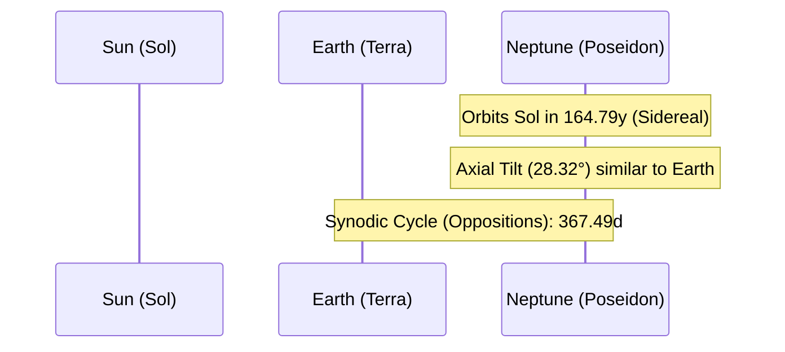

# Celestial Profile: Neptune (Poseidon)

This document provides the scientific classification, physical characteristics, and orbital mechanics of **Neptune**, the eighth and most distant major planet from the Sun. It serves as a technical reference for high-velocity wind structures, ice-giant thermodynamics, and satellite capture dynamics.

---

## 1. Classification & Identification

| Parameter | Scientific Value / Designation |
| :--- | :--- |
| **Official Name** | Neptune |
| **System** | Sol (Solar System) |
| **Primary Body** | Sol (Sun) |
| **Classification** | Ice Giant (Jovian Planet) |
| **Natural Satellites** | 16 confirmed (e.g., Triton, Nereid, Proteus) |

---

## 2. Physical Characteristics

Neptune is the fourth-largest planet by diameter and the third-largest by mass in the Solar System. It is slightly smaller but more massive than Uranus, making it the densest Jovian planet.

*   **Mean Radius ($R_N$)**: $24,622 \text{ km}$ ($3.86 \text{ Earth radii}$)
*   **Equatorial Circumference**: $154,705 \text{ km}$
*   **Mass ($M_N$)**: $1.0243 \times 10^{26} \text{ kg}$ ($17.15 \text{ Earth masses}$)
*   **Mean Density**: $1.638 \text{ g/cm}^3$ (densest of the Jovian planets; consists of a rocky core, a massive liquid water-ammonia-methane mantle, and a hydrogen-helium-methane atmosphere)
*   **Surface Gravity (1 bar level)**: $11.15 \text{ m/s}^2$ ($1.137 \text{ g}$)
*   **Escape Velocity ($v_e$)**: $23.5 \text{ km/s}$ ($84,600 \text{ km/h}$)
*   **Atmosphere**: Rich blue color caused by absorption of red light by atmospheric methane (composition: $80.0\%$ Hydrogen, $19.0\%$ Helium, $1.5\%$ Methane; features active planetary storms and the fastest winds in the Solar System, reaching $2,100 \text{ km/h}$).

---

## 3. Orbital Mechanics & Cycles

Neptune has the longest orbital period of any major planet, taking nearly $165$ Earth years to complete its path.

### A. Orbit Parameters
*   **Semi-major Axis ($a$)**: $4,495,060,000 \text{ km}$ ($30.07 \text{ AU}$)
*   **Perihelion (Closest Approach)**: $4,459,750,000 \text{ km}$ ($29.81 \text{ AU}$)
*   **Aphelion (Furthest Point)**: $4,536,870,000 \text{ km}$ ($30.33 \text{ AU}$)
*   **Orbital Eccentricity ($e$)**: $0.00945$ (nearly circular)
*   **Orbital Inclination ($i$)**: $1.769^\circ$ relative to the ecliptic plane.

### B. Rotational Mechanics
*   **Sidereal Rotation Period ($T_{rot}$)**: The interior and magnetic field rotate in:
    $$T_{rot} = 16\text{ hours } 6\text{ minutes } 36\text{ seconds} \quad (0.6713 \text{ days})$$
*   **Axial Tilt (Obliquity)**: $28.32^\circ$
    *   *Effect*: Experience seasonal shifts similar to Earth and Mars, but lasting over $40$ Earth years per season.

---

## 4. Earth-Neptune Synodic Cycle

Like Uranus, Neptune's synodic cycle is closely aligned with Earth's orbital period.

*   **Synodic Period ($T_y$)**: The average interval between successive oppositions.
    $$T_y = 367.49 \text{ days}$$

---

## 5. Magnetospheric & Satellite Dynamics

*   **Tilted Magnetic Field**: Neptune's magnetic field resembles Uranus's: its axis is tilted at $47^\circ$ to the rotation axis and offset from the center of the planet by $13,500\text{ km}$ ($0.55$ of the planet's radius). This generates complex magnetospheric fluctuations as the planet rotates.
*   **Triton Capture**: Neptune's largest moon, **Triton**, is unique for its **retrograde orbit** (orbiting in the opposite direction of Neptune's rotation) and composition similar to Pluto. This indicates Triton was captured from the Kuiper Belt by Neptune's gravity. Its orbit is decaying due to tidal deceleration, and Triton is expected to cross Neptune's Roche limit and disintegrate into a ring system in $\approx 3.6 \text{ billion years}$.
