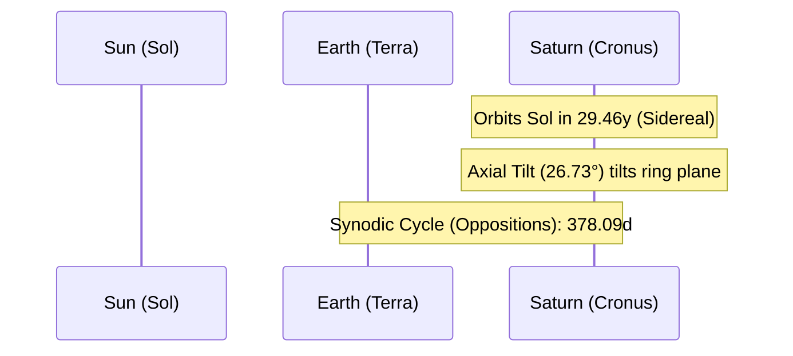

# Celestial Profile: Saturn (Cronus)

This document provides the scientific classification, physical characteristics, and orbital mechanics of **Saturn**, the sixth planet from the Sun. It serves as a technical reference for ring systems, low-density materials, and gravitational structures.

---

## 1. Classification & Identification

| Parameter | Scientific Value / Designation |
| :--- | :--- |
| **Official Name** | Saturn |
| **System** | Sol (Solar System) |
| **Primary Body** | Sol (Sun) |
| **Classification** | Ringed Gas Giant (Jovian Planet) |
| **Natural Satellites** | 146 confirmed (e.g., Titan, Enceladus, Mimas) |

---

## 2. Physical Characteristics

Saturn is the second-largest planet in the Solar System and is famous for its extensive ring system. It is the least dense of all planets, with a density less than that of liquid water.

*   **Mean Radius ($R_S$)**: $58,232 \text{ km}$ ($9.13 \text{ Earth radii}$)
*   **Equatorial Circumference**: $365,882 \text{ km}$
*   **Mass ($M_S$)**: $5.6834 \times 10^{26} \text{ kg}$ ($95.16 \text{ Earth masses}$)
*   **Mean Density**: $0.687 \text{ g/cm}^3$ (least dense major planet; would float in water; composed mostly of hydrogen and helium)
*   **Surface Gravity (1 bar level)**: $10.44 \text{ m/s}^2$ ($1.065 \text{ g}$)
*   **Escape Velocity ($v_e$)**: $35.5 \text{ km/s}$ ($127,800 \text{ km/h}$)
*   **Atmosphere**: Deep and hydrogen-dominant (composition: $96.3\%$ Hydrogen, $3.25\%$ Helium, with trace methane and ammonia; features active high-velocity jet streams reaching speeds of $1,800 \text{ km/h}$).

---

## 3. Orbital Mechanics & Cycles

Saturn has a slow, distant orbit around the Sun, requiring nearly three decades to complete a single orbital revolution.

### A. Orbit Parameters
*   **Semi-major Axis ($a$)**: $1,433,530,000 \text{ km}$ ($9.582 \text{ AU}$)
*   **Perihelion (Closest Approach)**: $1,352,550,000 \text{ km}$ ($9.041 \text{ AU}$)
*   **Aphelion (Furthest Point)**: $1,514,500,000 \text{ km}$ ($10.123 \text{ AU}$)
*   **Orbital Eccentricity ($e$)**: $0.0565$
*   **Orbital Inclination ($i$)**: $2.485^\circ$ relative to the ecliptic plane.

### B. Rotational Mechanics
*   **Sidereal Rotation Period ($T_{rot}$)**: Like Jupiter, Saturn rotates rapidly and exhibits differential rotation. The rotation of its magnetic field and interior is estimated at:
    $$T_{rot} = 10\text{ hours } 33\text{ minutes } 38\text{ seconds} \quad (0.43997 \text{ days})$$
*   **Axial Tilt (Obliquity)**: $26.73^\circ$
    *   *Effect*: Generates pronounced seasonal variations. Because the rings lie in Saturn's equatorial plane, their tilt relative to Earth observers oscillates over its $29$-year orbital cycle, resulting in "ring crossing" events where the rings appear edge-on and virtually disappear from view.

---

## 4. The Ring System

Saturn's rings are its most distinctive feature, extending from $6,630\text{ km}$ to $120,700\text{ km}$ above the equator, with a typical thickness of only $\approx 10\text{ meters}$.
*   **Composition**: $99\%$ pure water ice, with trace amounts of rocky debris and tholins.
*   **Structure**: Divided into major segments (A, B, C, D, E, F, G rings) separated by gaps such as the **Cassini Division** (a $4,800\text{ km}$ wide gap between the A and B rings, cleared by orbital resonances with the moon Mimas).

---

## 5. Magnetospheric & Satellite Dynamics

*   **Axisymmetric Magnetic Field**: Saturn's magnetosphere is generated by a liquid metallic hydrogen dynamo. Uniquely, its magnetic axis is almost perfectly aligned with its rotational axis (inclined by less than $0.1^\circ$).
*   **Major Satellites**: 
    *   **Titan**: The only satellite in the Solar System with a dense nitrogen-rich atmosphere ($1.45 \text{ bar}$) and active liquid hydrocarbon (methane/ethane) lakes.
    *   **Enceladus**: An icy moon featuring active south-polar cryovolcanic plumes that eject water vapor, salts, and organics into space, forming Saturn's E-ring.
