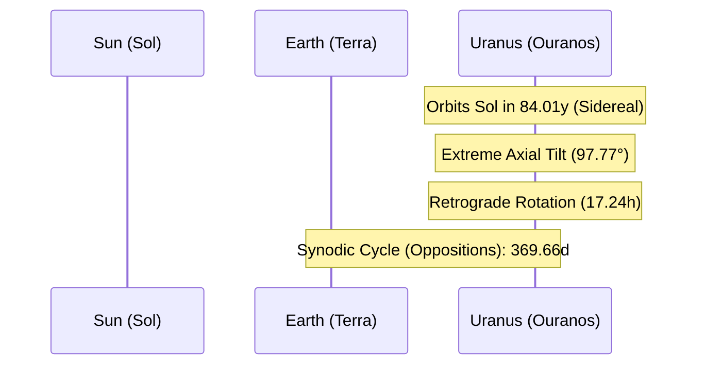

# Celestial Profile: Uranus (Ouranos)

This document provides the scientific classification, physical characteristics, and orbital mechanics of **Uranus**, the seventh planet from the Sun. It serves as a technical reference for high-axial tilt, ice-giant atmospheric dynamics, and retrograde planetary rotation.

---

## 1. Classification & Identification

| Parameter | Scientific Value / Designation |
| :--- | :--- |
| **Official Name** | Uranus |
| **System** | Sol (Solar System) |
| **Primary Body** | Sol (Sun) |
| **Classification** | Ice Giant (Jovian Planet) |
| **Natural Satellites** | 28 confirmed (e.g., Titania, Oberon, Ariel, Umbriel, Miranda) |

---

## 2. Physical Characteristics

Uranus is the third-largest planet by radius and the fourth-largest by mass in the Solar System. It is classified as an "Ice Giant," distinguished by an atmosphere rich in methane which gives it a pale cyan-blue color, and a mantle composed of high-pressure water, ammonia, and methane ices.

*   **Mean Radius ($R_U$)**: $25,362 \text{ km}$ ($3.98 \text{ Earth radii}$)
*   **Equatorial Circumference**: $159,354 \text{ km}$
*   **Mass ($M_U$)**: $8.6810 \times 10^{25} \text{ kg}$ ($14.54 \text{ Earth masses}$)
*   **Mean Density**: $1.27 \text{ g/cm}^3$ (low density, consisting of an icy mantle surrounding a rocky core)
*   **Surface Gravity (1 bar level)**: $8.69 \text{ m/s}^2$ ($0.886 \text{ g}$)
*   **Escape Velocity ($v_e$)**: $21.3 \text{ km/s}$ ($76,680 \text{ km/h}$)
*   **Atmosphere**: Coldest planetary atmosphere in the Solar System (composition: $82.5\%$ Hydrogen, $15.2\%$ Helium, $2.3\%$ Methane; minimum atmospheric temperature reaches $49 \text{ K}$ / $-224^\circ\text{C}$).

---

## 3. Orbital Mechanics & Cycles

Uranus orbits at an immense distance, taking eighty-four Earth years to complete its path.

### A. Orbit Parameters
*   **Semi-major Axis ($a$)**: $2,872,460,000 \text{ km}$ ($19.218 \text{ AU}$)
*   **Perihelion (Closest Approach)**: $2,748,900,000 \text{ km}$ ($18.389 \text{ AU}$)
*   **Aphelion (Furthest Point)**: $2,996,000,000 \text{ km}$ ($20.048 \text{ AU}$)
*   **Orbital Eccentricity ($e$)**: $0.0464$
*   **Orbital Inclination ($i$)**: $0.773^\circ$ relative to the ecliptic plane.

### B. Rotational Mechanics (Sideways Planet)
*   **Axial Tilt (Obliquity)**: $97.77^\circ$
    *   *Effect*: Uranus has an extreme axial tilt, rotating virtually on its side relative to the orbital plane. This causes extreme seasonal variations: during its $84$-year orbit, one pole points almost directly toward the Sun for $21$ years of continuous sunlight, followed by $21$ years of complete darkness.
*   **Sidereal Rotation Period ($T_{rot}$)**: Uranus rotates in a **retrograde** (clockwise) direction:
    $$T_{rot} = 17\text{ hours } 14\text{ minutes } 24\text{ seconds} \quad (0.71833 \text{ days})$$

---

## 4. Earth-Uranus Synodic Cycle

Due to Uranus's slow orbit, the synodic cycle matches the Earth's orbital period closely.

*   **Synodic Period ($T_y$)**: The interval between successive oppositions.
    $$T_y = 369.66 \text{ days}$$

---

## 5. Magnetospheric & Structural Dynamics

*   **Asymmetric Magnetic Field**: Uranus's magnetic field is unusual. The dipole axis is not centered in the planet's core and is tilted at $59^\circ$ to the rotational axis. The magnetic center is shifted from the physical center toward the south rotational pole by one-third of the planetary radius.
*   **Internal Heat Deficit**: Unlike the other Jovian planets, Uranus radiates very little heat into space beyond what it absorbs from the Sun. Its internal heat flux is lower than that of Earth, and the geological source of this thermal deficit remains an active area of investigation.
