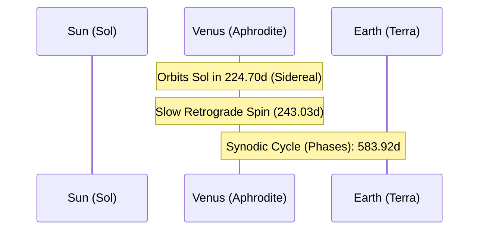

# Celestial Profile: Venus (Aphrodite)

This document provides the scientific classification, physical characteristics, and orbital mechanics of **Venus**, the second planet from the Sun. It serves as a technical reference for greenhouse effects, planetary rotation, and thermal calculations.

---

## 1. Classification & Identification

| Parameter | Scientific Value / Designation |
| :--- | :--- |
| **Official Name** | Venus |
| **System** | Sol (Solar System) |
| **Primary Body** | Sol (Sun) |
| **Classification** | Inner Terrestrial Planet |
| **Status** | Slow Retrograde Rotation |

---

## 2. Physical Characteristics

Venus is often described as Earth's sister planet due to their similar size and mass. However, Venus possesses a crushing atmosphere and extreme runaway greenhouse temperatures, making it the hottest planet in the Solar System.

*   **Mean Radius ($R_V$)**: $6,051.8 \text{ km}$ ($0.9499 \text{ Earth radii}$)
*   **Equatorial Circumference**: $38,025 \text{ km}$
*   **Mass ($M_V$)**: $4.8675 \times 10^{24} \text{ kg}$ ($0.815 \text{ Earth masses}$)
*   **Mean Density**: $5.243 \text{ g/cm}^3$ (metal core, silicate mantle, and thin crust)
*   **Surface Gravity ($g_V$)**: $8.87 \text{ m/s}^2$ ($0.904 \text{ g}$)
*   **Escape Velocity ($v_e$)**: $10.36 \text{ km/s}$ ($37,296 \text{ km/h}$)
*   **Atmosphere**: Extremely dense (composition: $96.5\%$ Carbon Dioxide, $3.5\%$ Nitrogen; surface pressure is $92 \text{ bar}$, equivalent to being $900 \text{ m}$ underwater on Earth).
*   **Surface Temperature**: $737 \text{ K}$ ($464^\circ\text{C}$ / $867^\circ\text{F}$ average), held constant by a thick greenhouse blanket of $CO_2$ and sulfur dioxide cloud decks.

---

## 3. Orbital Mechanics & Cycles

Venus has the most circular orbit of any major planet in the Solar System.



### A. Orbit Parameters
*   **Semi-major Axis ($a$)**: $108,208,000 \text{ km}$ ($0.7233 \text{ AU}$)
*   **Perihelion (Closest Approach)**: $107,477,000 \text{ km}$ ($0.7184 \text{ AU}$)
*   **Aphelion (Furthest Point)**: $108,939,000 \text{ km}$ ($0.7282 \text{ AU}$)
*   **Orbital Eccentricity ($e$)**: $0.0067$ (nearly circular)
*   **Orbital Inclination ($i$)**: $3.394^\circ$ relative to the ecliptic plane.

### B. Rotational Mechanics (Retrograde Obliquity)
*   **Sidereal Rotation Period ($T_{rot}$)**: Venus rotates in a **retrograde** (clockwise) direction, opposite to most planets. Its rotation is extremely slow:
    $$T_{rot} = 243.025 \text{ days} \quad (5,832.6\text{ hours})$$
    *   *Note*: A Venusian sidereal day is longer than its orbital year ($224.70$ days).
*   **Synodic Solar Day ($T_{solar}$)**: Because of the combination of retrograde spin and orbital progression, the Sun rises in the west and sets in the east, with the noon-to-noon cycle lasting:
    $$T_{solar} = 116.75 \text{ days} \quad (2,802\text{ hours})$$
*   **Axial Tilt (Obliquity)**: $177.3^\circ$ (effectively inverted, which is why its rotation is classified as retrograde).

---

## 4. Synodic Phase Cycle (Earth Observation)

Like Mercury, Venus is an inferior planet and exhibits a full phase cycle when viewed from Earth. Due to its thick reflective sulfuric acid clouds, its albedo is very high ($0.90$), making it the brightest natural object in the night sky after Luna.

*   **Synodic Period ($T_y$)**: The average interval between successive inferior conjunctions.
    $$T_y = 583.92 \text{ days}$$

```
[Inferior Conjunction] ──> [Max Eastern Elongation] ──> [Superior Conjunction] ──> [Max Western Elongation]
    (New Phase)                 (Half/Dichotomy)              (Full Phase)               (Half/Dichotomy)
```

| Phase Position | Description | Elongation Angle ($\epsilon$) | Phase Fraction (Illumination) |
| :--- | :--- | :---: | :---: |
| **Inferior Conjunction** | Positioned directly between Earth and Sun (Dark/New Phase). | $0^\circ$ | $0.0$ |
| **Max Eastern Elongation** | Furthest east of the Sun; visible as the "Evening Star." | $\approx 47^\circ$ | $\approx 0.5$ (Dichotomy) |
| **Superior Conjunction** | Positioned directly behind the Sun relative to Earth. | $0^\circ$ (behind Sun) | $1.0$ (Full / Brightest) |
| **Max Western Elongation** | Furthest west of the Sun; visible as the "Morning Star." | $\approx 47^\circ$ | $\approx 0.5$ (Dichotomy) |
