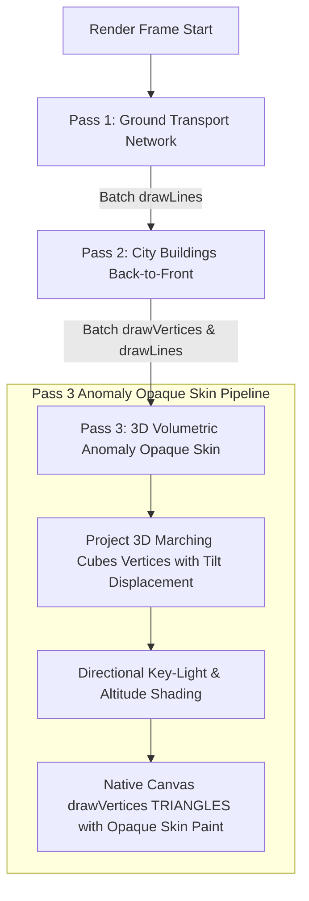

# Anomaly Volumetric Generation, Storage & Nodal Targeting Specification

This document details the procedural mathematical models, data structures, rendering architecture, and gameplay targeting mechanics of **3D Volumetric Anomalies** in the GENPOX network.

---

## 1. Executive Summary & Data Compatibility

Anomalies in GENPOX are towering, multi-kilometer organic and electromagnetic bio-mass entities that spawn across real-world geographic coordinates. Rather than storing millions of polygons or gigabytes of mesh data in the database, GENPOX uses a **procedural synthesis architecture** that is 100% backwards-compatible with the original [`PoxAnomaly`](file:///c:/Users/brent/Antigravity/GENPOX/pox-android/app/src/main/java/com/example/genpox/data/Models.kt) data record.

```
+-------------------------------------------------------------------------------+
|                             BACKEND / DATABASE                                |
|                                                                               |
|  PoxAnomaly (Lean JSON / Firestore):                                          |
|    - id: "anom_delta_42"                                                      |
|    - lat: 37.7749, lng: -122.4194                                            |
|    - heatZoneDiameter: 6561.68 ft (2000 m)                                    |
|    - gene: "A3T9CG01", faction: "Infection", density: 0.85                   |
+---------------------------------------+---------------------------------------+
                                        | (Zero schema change / 0 extra bytes)
                                        v
+-------------------------------------------------------------------------------+
|                       DETERMINISTIC EMITTER SYNTHESIS                         |
|                                                                               |
|  MetaballMeshCompiler.generateProceduralEmitters(centerX, centerY, R, seed)   |
|    - 1 Primary Central Core  (Summit peak, Z = 400m-850m)                     |
|    - 4 Ground-Spread Lobes   (Perimeter sprawl across city blocks)            |
|    - 2 Satellite Spires      (Outlier energy nodes)                           |
+-------------------+---------------------------------------+-------------------+
                    |                                       |
                    v                                       v
+---------------------------------------+   +-----------------------------------+
|          GAMEPLAY TARGETING           |   |       MAP RENDERING ENGINE        |
|                                       |   |                                   |
| - resolveNodalStructure(anomaly)      |   | - Marching Squares Contour Loops  |
| - Targetable Sub-Node Lat/Lng/Alt     |   | - 3-Pass Volumetric Slice Fills   |
| - Volumetric contains3D(lat, lng, z)  |   | - Multi-Harmonic Scanner Sweeps   |
| - Gene Harvesting & Node Disruption   |   | - Zero Allocations @ 120 FPS      |
+---------------------------------------+   +-----------------------------------+
```

---

## 2. Storage Model & Backward Compatibility

### 2.1 The Core Anomaly Record
Anomalies are persisted in [`Models.kt`](file:///c:/Users/brent/Antigravity/GENPOX/pox-android/app/src/main/java/com/example/genpox/data/Models.kt) as:
```kotlin
@Serializable
data class PoxAnomaly(
    override val id: String,
    val name: String,
    override val lat: Double,
    override val lng: Double,
    val gene: String,
    val faction: String,
    val distance: Double,
    val heatZoneDiameter: Double, // Diameter in feet
    val density: Double = 0.0,
) : GeographicHazard
```

### 2.2 Deterministic Coordinate Seeding
All internal sub-nodes, lobes, and 3D terrain slices are derived deterministically using a 64-bit coordinate hash:
$$\text{Seed} = (\text{lat.hashCode}() \ll 32) \oplus (\text{lng.hashCode}() \ \& \ \text{0xFFFFFFFF})$$
* **Zero Database Storage Overhead**: Sub-node positions and 3D contours are never written to disk or transmitted over the network; they are computed on-the-fly in $< 2.5\text{ms}$.
* **Cross-Client Consistency**: Every player running GENPOX sees the exact same nodal positions, peak summits, and contour shapes at any given anomaly.

---

## 3. The 3D Anisotropic Metaball Mathematical Model

Anomalies are defined as an implicit scalar density field $F(x, y, z) \in [0, \infty)$ generated by a cluster of anisotropic ellipsoidal emitters:

### 3.1 Wyvill Anisotropic Cubic Decay Potential
For an emitter $i$ located at $(x_i, y_i, z_i)$ with horizontal radius $R_{xy, i}$, vertical radius $R_{z, i}$, and weight $w_i$:
$$d_{\text{norm}, i}^2 = \left(\frac{x - x_i}{R_{xy, i}}\right)^2 + \left(\frac{y - y_i}{R_{xy, i}}\right)^2 + \left(\frac{z - z_i}{R_{z, i}}\right)^2$$

The scalar field contribution $f_i(x, y, z)$ is given by the smooth Wyvill cubic polynomial:
$$f_i(x, y, z) = \begin{cases}
w_i \cdot (1 - d_{\text{norm}, i}^2)^3 & \text{if } d_{\text{norm}, i}^2 < 1.0 \\
0 & \text{if } d_{\text{norm}, i}^2 \ge 1.0
\end{cases}$$

The total field density is the linear superposition:
$$F(x, y, z) = \sum_{i=1}^{M} f_i(x, y, z)$$

### 3.2 Isosurface Boundary Threshold
The visible and physical boundary of the anomaly is defined by the isosurface:
$$\mathcal{S} = \left\{(x, y, z) \in \mathbb{R}^3 \ \big| \ F(x, y, z) = T_{\text{iso}} = 0.22\right\}$$
* **Aspect Ratio**: Radii are tuned to a **2:1 horizontal-to-vertical ratio** ($R_{xy} \approx 800\text{m}\dots 1200\text{m}$, $H_{\max} \approx 400\text{m}\dots 900\text{m}$), producing a massive volcanic bio-mass that sprawls across city sectors while towering above skyscrapers.

---

## 4. Nodal Structure & Gameplay Targeting

Every anomaly contains a structured hierarchy of **7 distinct tactical nodes** generated by [`MetaballMeshCompiler.resolveNodalStructure()`](file:///c:/Users/brent/Antigravity/GENPOX/pox-android/app/src/main/java/com/example/genpox/ui/scanner/map/MetaballMeshCompiler.kt):

```
                        [Node 0: CORE_SUMMIT]
                           (Z = 600m-850m)
                                /|\
                               / | \
                              /  |  \
       [Node 5: SATELLITE]  /   |   \  [Node 6: SATELLITE]
         (Z = 200m-350m)   /     |    \  (Z = 200m-350m)
                          /      |     \
    [Node 1: GROUND] ---+        |      +--- [Node 3: GROUND]
      (Z = 30m-80m)     \       |      /       (Z = 30m-80m)
                         \      |     /
    [Node 2: GROUND] -----+-----+----+------ [Node 4: GROUND]
      (Z = 30m-80m)                             (Z = 30m-80m)
```

### 4.1 Node Hierarchy & Classifications

| Node Index | Type | Altitude ($Z$) | Radius ($R_{xy}$) | Role / Gameplay Interaction |
| :--- | :--- | :--- | :--- | :--- |
| **Node 0** | `CORE_SUMMIT` | $600\text{m}\dots 850\text{m}$ | $600\text{m}\dots 900\text{m}$ | **Primary Nexus**: Highest gene rarity yield; heavily protected by forcefields until sub-nodes are destabilized. |
| **Nodes 1–4** | `GROUND_LOBE` | $30\text{m}\dots 80\text{m}$ | $400\text{m}\dots 650\text{m}$ | **Ground anchors**: Sprawling lobes positioned in surrounding streets; targeted for ground-level specimen harvests. |
| **Nodes 5–6** | `SATELLITE_SPIRE` | $200\text{m}\dots 350\text{m}$ | $350\text{m}\dots 500\text{m}$ | **Outlier Outposts**: Elevated secondary peaks; provide bonus tactical telemetry and radar resonance boosts. |

### 4.2 Querying Nodes in Gameplay Code
To resolve the real-world GPS coordinates and altitudes of all nodes for an anomaly:
```kotlin
val nodalStructure = MetaballMeshCompiler.resolveNodalStructure(anomaly)

for (node in nodalStructure.nodes) {
    println("Node ${node.index}: Type=${node.type}")
    println("  GPS: (${node.lat}, ${node.lng})")
    println("  Altitude: ${node.altitudeMeters}m above ground")
    println("  Energy Weight: ${node.weight}")
}
```

### 4.3 Volumetric 3D Containment & Hazard Checks
To determine whether a player, drone, or specimen is physically located within the anomaly's 3D bio-mass:
```kotlin
val isInsideBioMass = MetaballMeshCompiler.contains3D(
    anomaly = anomaly,
    targetLat = playerLat,
    targetLng = playerLng,
    targetAltitudeMeters = playerAltitude,
    densityThreshold = 0.22f
)
```

---

## 5. Map Rendering & Tactical Animation Architecture

Rendering is implemented in [`StaticMapLayer.kt`](file:///c:/Users/brent/Antigravity/GENPOX/pox-android/app/src/main/java/com/example/genpox/ui/scanner/map/StaticMapLayer.kt) using a **3-Pass Volumetric Layering Pipeline** with **Zero Native Memory Allocations**:



### 5.1 The 3-Pass Layering Architecture
1. **Pass 1 (Roads)**: Ground transport segments rendered on baseline terrain ($Z = 0$).
2. **Pass 2 (Buildings)**: All city buildings (walls, roof fills, roof rims) rendered in unified depth order.
3. **Pass 3 (Anomaly Opaque Skin)**: The 3D volumetric bio-mass (Spike or Sprawl) is rendered as a unified **simple opaque skin** for the entire shape using hardware-accelerated `Canvas.drawVertices(VertexMode.TRIANGLES, ...)`:
   * **Full Opacity in 3D**: Rendered with solid `Paint.Style.FILL` and 100% alpha (`ARGB(255, R, G, B)`).
   * **2D-to-3D Viewport Cross-Fade**: When looking straight down (`tiltProgress <= 0.03f`), the 3D skin yields to the 2D ground footprint underlay (Pass 1.5); as the camera tilts into 3D, the opaque skin smoothly transitions to full opacity.
   * **Directional Shading**: Ambient + directional key lighting from top-front-right ($\vec{L} = [0.35, -0.45, 0.82]$) combined with an altitude gradient creates organic relief, accentuating tapering spires, needle tips, and perimeter sprawling lobes.
   * **Zero Allocations @ 120 FPS**: Uses pre-allocated primitive vertex and color buffers (`projectedVerticesBuffer`, `projectedAnomalyColorsBuffer`).

---

## 6. Codebase Reference Map

| Component | Source File | Key Responsibilities |
| :--- | :--- | :--- |
| **Metaball Compiler** | [`MetaballMeshCompiler.kt`](file:///c:/Users/brent/Antigravity/GENPOX/pox-android/app/src/main/java/com/example/genpox/ui/scanner/map/MetaballMeshCompiler.kt) | 3D potential field evaluation, emitter generation, 2D Marching Squares loop stitching, nodal structure resolution, and `contains3D` volumetric checks. |
| **Sector Compiler** | [`SectorMeshCompiler.kt`](file:///c:/Users/brent/Antigravity/GENPOX/pox-android/app/src/main/java/com/example/genpox/ui/scanner/map/SectorMeshCompiler.kt) | Assembles roads, extruded buildings, and 28-slice anomaly meshes into `Baked3DSectorMesh` buffers. |
| **Map Layer Renderer** | [`StaticMapLayer.kt`](file:///c:/Users/brent/Antigravity/GENPOX/pox-android/app/src/main/java/com/example/genpox/ui/scanner/map/StaticMapLayer.kt) | GPU-transformed 3-pass hardware rendering, tilt displacement, and real-time paint parameter modulation. |
| **Deployment Engine** | [`DeploymentEngine.kt`](file:///c:/Users/brent/Antigravity/GENPOX/pox-android/app/src/main/java/com/example/genpox/data/DeploymentEngine.kt) | Haversine distance, boundary forcefield calculations, and synodic lunar modifiers. |
| **Data Models** | [`Models.kt`](file:///c:/Users/brent/Antigravity/GENPOX/pox-android/app/src/main/java/com/example/genpox/data/Models.kt) | `PoxAnomaly`, `Baked3DSectorMesh`, and `GeographicHazard` interfaces. |
