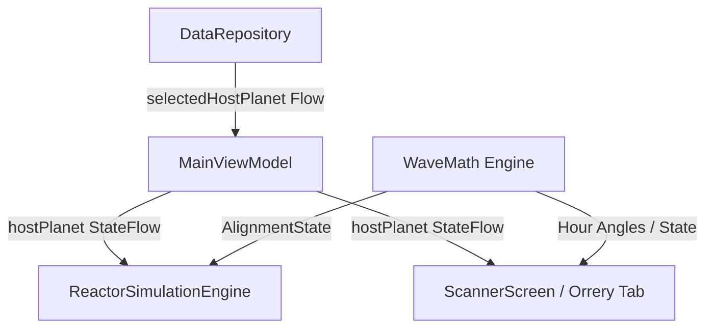

# G.E.N. P.O.X. Single-Node Cybernetic Orrery Technical Design Document

This document outlines the architecture, mathematical formulations, and user interface details of the **Single-Node Cybernetic Orrery** subtab in the G.E.N. P.O.X. scanner interface.

---

## 1. System Architecture

The Orrery system is integrated across the data, simulation, and presentation layers of the application:



### Data Flow Components:
1. **Preferences Storage**: The active host planet is persisted across sessions in `PoxSettings` under the key `selected_host_planet`.
2. **ViewModel Propagation**: `MainViewModel` exposes the selected planet as a `StateFlow` and provides a setter `changeHostPlanet(planet: String)` to write updates to preferences.
3. **Simulation Hook**: When synthesis is initiated, the selected host planet is passed into `ReactorSimulationEngine.runSynthesis`, determining the active **Anomalous Base Window**.

---

## 2. Keplerian & Diurnal Mathematics

### Heliocentric Orbit Coordinates (`getHeliocentricPosition`)
Planetary positions are calculated using 2D Keplerian orbital elements at a given time $t$ (days since epoch):
- **Mean Anomaly ($M$)**:
  $$M = \frac{2\pi \cdot t}{P} \pmod{2\pi}$$
  where $P$ is the orbital period in days.
- **Eccentric Anomaly ($E$)**:
  Solved iteratively via Newton-Raphson (5 steps):
  $$E_{n+1} = E_n - \frac{E_n - e \sin(E_n) - M}{1 - e \cos(E_n)}$$
- **Orbital Plane coordinates ($x', y'$)**:
  $$x' = a(\cos(E) - e), \quad y' = a\sqrt{1-e^2}\sin(E)$$
  where $a$ is the semi-major axis and $e$ is eccentricity.
- **Ecliptic Coordinate rotation**:
  Rotate by the longitude of perihelion ($\bar{\omega}$):
  $$x = x'\cos(\bar{\omega}) - y'\sin(\bar{\omega}), \quad y = x'\sin(\bar{\omega}) + y'\cos(\bar{\omega})$$

### Geocentric Longitudes ($\lambda$)
Observer coordinates are relative to Earth's heliocentric position $(x_E, y_E)$:
- **Standard planets**:
  $$\lambda = \text{atan2}(y - y_E, x - x_E)$$
- **Earth (Option A: Sun Proxy)**:
  $$\lambda_{\odot} = \text{atan2}(-y_E, -x_E)$$

### Local Hour Angles ($HA$)
Local Hour Angle represents a planet's angle relative to the observer's local meridian:
- **Greenwich Mean Solar Angle**:
  $$\theta_{\text{G}} = 2\pi \cdot \left(\frac{t_{\text{ms}} \pmod{86400000}}{86400000} + 0.5\right)$$
- **Local Sidereal Time (LST)**:
  $$LST = \theta_{\text{G}} + \lambda_{\odot} + \text{longitude}_{\text{obs}}$$
- **Hour Angle**:
  $$HA = LST - \lambda_{\text{planet}} \pmod{2\pi}$$
  *For Earth (Sun Proxy), $HA_{\odot} = \theta_{\text{G}} + \text{longitude}_{\text{obs}}$, yielding exactly 0.0 at local solar noon.*

---

## 3. UI Projection and Rendering

The `PlanetTransitArcPanel` renders the diurnal paths by projecting 3D tilted circles onto the observer's 2D meridian grid:

1. **Declination ($\delta$)**:
   $$\delta = \arcsin(0.3978 \sin(\lambda))$$
2. **Vertical Shift**:
   $$cy_{\text{shifted}} = cy - r \cdot \sin(\text{lat}) \cdot \sin(\delta)$$
3. **Projected Radius**:
   $$r_{\text{projected}} = r \cdot \cos(\text{text}) \cdot \cos(\delta) \quad (\text{coerced to } \ge 0.2r)$$
4. **Split-Horizon Rendering**:
   Nested `clipRect` bounds split path rendering cleanly at the horizon line `cy`:
   - `top = 0f, bottom = cy` draws the solid above-horizon segment.
   - `top = cy, bottom = h` draws the dashed below-horizon segment.

---

## 4. Conjunction / Opposition Alignment Logic

Alignment state checks are determined by the absolute angular separation of the geocentric longitudes:
$$\Delta\lambda = |\lambda_1 - \lambda_2| \pmod{2\pi}$$
$$\text{If } \Delta\lambda > \pi, \quad \Delta\lambda = 2\pi - \Delta\lambda$$

The separation angle $\theta_{\text{sep}} = \text{deg}(\Delta\lambda)$ determines the active alignment:
- **CONJUNCTION**: $\theta_{\text{sep}} < 30^\circ$
- **OPPOSITION**: $\theta_{\text{sep}} \ge 150^\circ$
- **QUADRATURE**: $75^\circ \le \theta_{\text{sep}} \le 105^\circ$
- **NEUTRAL**: Any other separation.

---

To support execution of unit tests across coroutine dispatchers without state loss during thread switching, the global test mode bypass is marked as `@Volatile`:

```kotlin
object WaveMath {
    @Volatile
    var isTestMode: Boolean = false
}
```

This ensures that asynchronous tests running under coroutine dispatchers (e.g. `MainScreenViewModelTest` and `ReactorSimulationTest`) propagate the test bypass flag correctly across thread suspensions, securing 100% test run deterministic fidelity.
