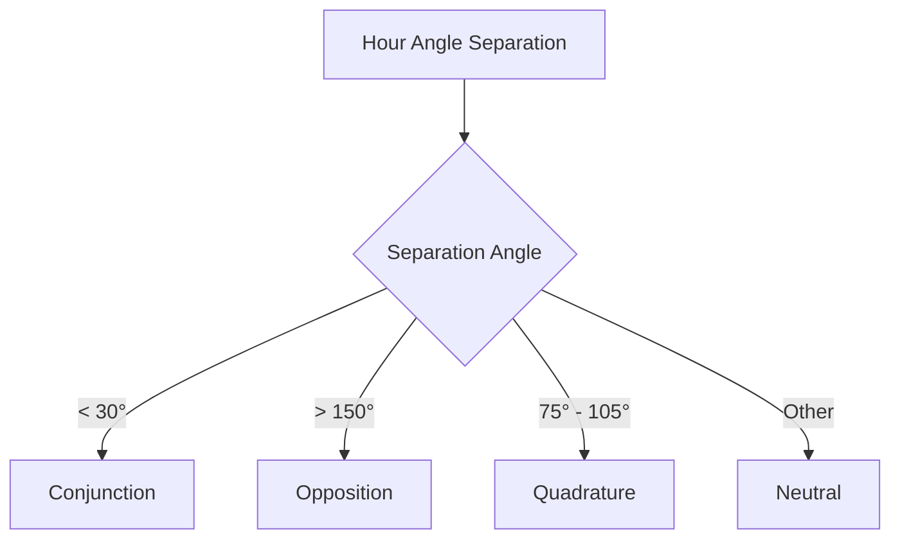

# G.E.N. P.O.X. Cyber Orrery & Diurnal Alignment Guide

Welcome to the **Single-Node Cybernetic Orrery** interface. By tracking the positions of the solar system's planets relative to Earth's diurnal rotation, you can master alignments to optimize gene synthesis, mitigate mutations, and synthesize anomalous bases.

---

## 1. Choosing a Host Planet

Selecting a Host Planet determines which step (index 1–8) of your 8-character gene sequence serves as the **Anomalous Window**. During synthesis, the step corresponding to your selected Host Planet has a chance to incorporate an anomalous base (e.g., `X`, `Z`, `Y`, `W`) if environmental conditions and Q-scores are met.

| Host Planet | Target Sequence Index | Associated Base Pair Group |
| :--- | :---: | :--- |
| **Mercury** | Index 1 | Adenine (A) |
| **Venus** | Index 2 | Adenine (A) |
| **Earth** | Index 3 | Guanine (G) |
| **Mars** | Index 4 | Guanine (G) |
| **Jupiter** | Index 5 | Thymine (T) |
| **Saturn** | Index 6 | Thymine (T) |
| **Uranus** | Index 7 | Cytosine (C) |
| **Neptune** | Index 8 | Cytosine (C) |

---

## 2. Diurnal Transit Pairings & Alignment States

The 8 planets are grouped into 4 **Host Pairs** that govern the physical stability and mutation rates of their corresponding base characters. As Earth rotates, the relative separation angle between each pair's local Hour Angles transitions through four distinct states over a 24-hour cycle:

### 🪐 Conjunction (Synergy)
* **Trigger**: Separation angle $< 30^\circ$.
* **Base Buff**: **+5.0 Phred Q-Score** to steps synthesizing the associated base.
* **Fidelity Buff**: Crosstalk mutation rate is **halved ($0.5\times$)**.
* **Anomalous Window**: Boosts anomalous base bonding chance to **40%** and reduces the minimum Q-score threshold to **$\ge 22.0$**.

### ⚡ Opposition (Turbulence)
* **Trigger**: Separation angle $\ge 150^\circ$.
* **Base Penalty**: **-6.0 Phred Q-Score** to steps synthesizing the associated base.
* **Fidelity Penalty**: Crosstalk mutation rate is **doubled ($2.0\times$)**.
* **Anomalous Window**: Lowers anomalous base bonding chance to **15%** (requires Q-score $\ge 28.0$).

### 📐 Quadrature (Tension)
* **Trigger**: Separation angle between $75^\circ$ and $105^\circ$.
* **Thermal Shift**: Shifts the base's local $T_m$ (Melting Temperature) contribution by **$+4.0^\circ\text{C}$**.
* **Anomalous Window**: Anomalous base bonding is restricted to a tight temperature envelope (**$\pm 1.5^\circ\text{C}$** of the shifted $T_m$), with a **20%** success chance.

### ⚪ Neutral
* **Trigger**: Any other separation angle.
* **Effects**: Standard biophysical values and mutation rates.
* **Anomalous Window**: Requires Q-score **$\ge 28.0$** and has a **20%** success chance.

---

## 3. Tactical Gameplay Tips

> [!TIP]
> **Check the Orrery Before Synthesis Runs**
> Look at the Cyber Orrery subtab to see which orbits are highlighted. Plan your sequence targets around active conjunctions to secure high Q-scores.

> [!WARNING]
> **Beware of Quadrature Thermal Surges**
> When a base pair is in Quadrature, its melting point rises by $+4.0^\circ\text{C}$. If your target sequence has multiple characters governed by that pair (e.g., multiple `C`s when Uranus & Neptune are in Quadrature), your overall $T_m$ will rise significantly. Increase the chamber heater to match!

> [!IMPORTANT]
> **Splicing Anomalous Genes**
> Splicing anomalous bases requires high sequence fidelity. Try selecting a Host Planet whose associated pair is currently in **Conjunction**. The lowered Q-score threshold ($\ge 22.0$) and high success rate (40%) make bonding much easier to achieve.

---

## 4. Local Geocentric Sky Dome Tracking

The Cyber Orrery tracks planet positions from the **observer's local perspective on Earth** by utilizing real-time GPS coordinates (Latitude & Longitude) and local system time:

### Orbit Visualization & Projections:
- **Tilted Orbits**: Orbit trajectories are drawn as concentric circles whose centers are shifted along the meridian line and whose radii are compressed to represent their 3D declination ($\delta$) and latitude ($\phi$) projection on the sky dome.
- **Split-Hemisphere Color Coding**:
  - **Above the horizon (Day/Sky)**: Drawn as a solid **Cyber Cyan** (`0xFF00E5FF`) line.
  - **Below the horizon (Night/Nadir)**: Drawn as a dashed vibrant **Cyber Purple** (`0xFFD500F9`) line.
- **Dynamic Coordinates**: Planet positions on their orbits dynamically transit based on their Local Hour Angle, rising in the East and setting in the West.
- **Planet Cyber Colors**: Each planet is rendered in its own dedicated retro-cyber variant color:
  - **Mercury**: Cyber Silver
  - **Venus**: Cyber Gold
  - **Earth (Sun Proxy)**: Cyber Ocean Blue
  - **Mars**: Cyber Orange-Red
  - **Jupiter**: Cyber Amber
  - **Saturn**: Cyber Sandy Straw
  - **Uranus**: Cyber Aquamarine
  - **Neptune**: Cyber Royal Blue
  *Dots below the horizon fade to 40% opacity, while the selected planet's highlight reticle ring remains at 100% full brightness for readability.*

### Holographic HUD Elements:
- **Clock Hands**: Radial lines point from the center coordinates `(cx, cy)` (representing the observer) to each planet dot, color-coded to the active alignment state.
- **Separation Sector (Wedge)**: A semi-transparent shaded pie wedge and boundary arc indicate the angular separation between the two planets.
- **State-Reactive HUD Colors**: The clock face elements and Top-Right telemetry text dynamically change color based on the current alignment state:
  - **Conjunction**: Glowing Neon **Cyber Green**
  - **Opposition**: Warning Neon **Cyber Red**
  - **Neutral/Quadrature**: Technical Neon **Cyber Yellow**

### Telemetry Corners:
- **Top-Left**: Displays local diurnal transit hour angles in hours/minutes (e.g. `14h 32m`) for both planets.
- **Top-Right**: Shows the angular separation difference and active alignment state.
- **Bottom-Left**: Displays the current active Q-score and mutation rate modifiers.
- **Bottom-Right**: Lists anomalous base bonding success rates and minimum requirements.
