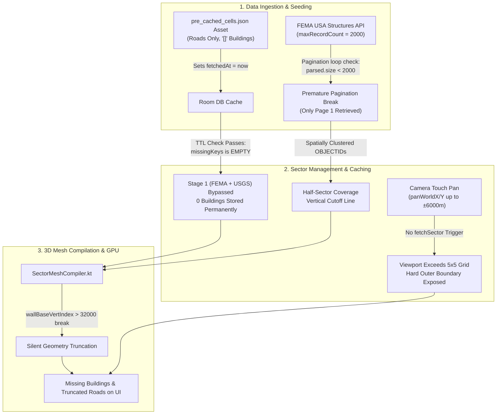
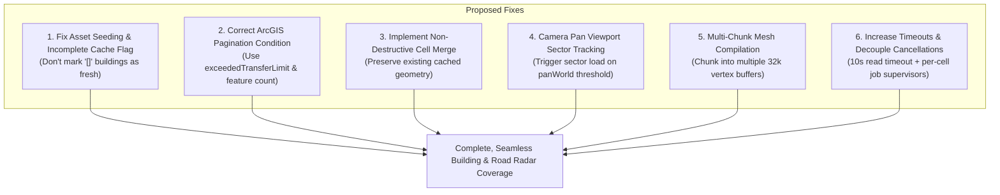

# GENPOX Scanner Tab: Missing Buildings & Road Discontinuity Investigation Report

**Target Subsystem:** Scanner Radar Engine ([`MapSectorManager.kt`](file:///c:/Users/brent/Antigravity/GENPOX/pox-android/app/src/main/java/com/example/genpox/ui/scanner/map/MapSectorManager.kt), [`SectorMeshCompiler.kt`](file:///c:/Users/brent/Antigravity/GENPOX/pox-android/app/src/main/java/com/example/genpox/ui/scanner/map/SectorMeshCompiler.kt), [`HolographicRadarScanner.kt`](file:///c:/Users/brent/Antigravity/GENPOX/pox-android/app/src/main/java/com/example/genpox/ui/scanner/map/HolographicRadarScanner.kt))  
**Telemetry & Test Data:** Kansas City ($39.171^\circ\text{N}, -94.463^\circ\text{W}$) and Silicon Valley ($37.422^\circ\text{N}, -122.084^\circ\text{W}$) sector profiles  
**Input Artifacts:** Attached scanner screenshots (`media_1789750913014.png`, `media_1789750913795.png`, `media_1789750913304.png`)

---

## 1. Executive Summary

Inspection of the user-provided screenshots reveals severe spatial data dropouts across the 2D/3D Scanner radar visualizer:
1. **Vertical/Horizontal Cleave Lines**: In Screenshots 1 and 2, dense residential building footprints and road polylines terminate abruptly along razor-straight linear boundaries. On one side of the line, cul-de-sacs and building polygons are richly populated; on the other side, the terrain is completely vacant except for isolated geometry.
2. **Road Vectors Terminating in Empty Space**: In Screenshot 3, major and residential road lines extend into neighboring grid sectors and abruptly cut off mid-span.

A code-level architectural forensic audit of the GIS data pipeline isolates these anomalies to **six compounding root causes** spanning cache seeding, pagination logic, cache invalidation, camera pan decoupling, and vertex buffer limits.



---

## 2. Evidence Analysis from User Screenshots

| Screenshot | Timestamp | View Mode | Observed Anomaly | Forensic Indicator |
| :--- | :---: | :---: | :--- | :--- |
| **Screenshot 1** (`...014.png`) | 12:00 | `2D TOP` | Left 35% of display shows dense suburban cul-de-sacs and building footprints. Right 65% is barren; roads and buildings cut off at a vertical seam. | Internal cell boundary seam where cell $(X, Y)$ had Stage 1 FEMA data, but cell $(X, Y+1)$ had seeded roads with `"[]"` buildings, or FEMA query halted at 2,000 features. |
| **Screenshot 2** (`...795.png`) | 12:01 | `2D TOP` | Right 40% of display shows dense cul-de-sacs and buildings. Left 60% shows roads extending slightly past the boundary line before abruptly terminating. | Inverted perspective of the same seam after camera panning or sector transition; unseeded/unfetched cells produce zero geometry. |
| **Screenshot 3** (`...304.png`) | 12:00 | `2D TOP` | Major road runs North-South. East-West roads abruptly terminate into empty grid space on the left and center. Sparse buildings in lower right only. | Viewport panned beyond the queried $5 \times 5$ cell radius (`panWorldX / Y`), exposing the unqueried perimeter of the sector envelope. |

---

## 3. Deep-Dive Root Cause Analysis

### Cause 1: Offline Asset Seeding Poisoning the TTL Freshness Filter
* **Source Location:** [`MapSectorManager.kt#L881-L917`](file:///c:/Users/brent/Antigravity/GENPOX/pox-android/app/src/main/java/com/example/genpox/ui/scanner/map/MapSectorManager.kt#L881-L917) and [`MapSectorManager.kt#L262-L307`](file:///c:/Users/brent/Antigravity/GENPOX/pox-android/app/src/main/java/com/example/genpox/ui/scanner/map/MapSectorManager.kt#L262-L307)
* **Mechanism:**
  When the app initializes in an area covered by `pre_cached_cells.json` (e.g. Kansas City, $39.015^\circ - 39.345^\circ\text{N}$, $-94.65^\circ - -94.20^\circ\text{W}$, containing 410 pre-indexed cells):
  1. `seedFromAssetIfAvailable` extracts roads from the offline asset, but sets:
     ```kotlin
     cells.add(CachedMapCell(key, roadsJson, "[]", now))
     ```
  2. The cell is inserted into SQLite Room DB with `buildingsJson = "[]"` and `fetchedAt = System.currentTimeMillis()`.
  3. `loadSector` immediately evaluates freshness:
     ```kotlin
     val freshCells = cachedCells.filter { it.fetchedAt > 0L && (now - it.fetchedAt) < MAP_CELL_TTL_MS }
     val freshKeys = freshCells.map { it.cellKey }.toSet()
     val missingKeys = cellsToQuery.filter { !freshKeys.contains(it) }

     if (missingKeys.isEmpty()) {
         runStage2OsmEnrichment(lat, lng, cellsToQuery, now, logEmitter, onUpdate)
         return@launch
     }
     ```
  4. Because `fetchedAt = now`, `missingKeys` is evaluated as **EMPTY**.
  5. **Stage 1 Critical Path (FEMA USA Structures + USGS Structures) is completely skipped!**
  6. Stage 2 (`runStage2OsmEnrichment`) queries only OpenStreetMap (`[building]`). In suburban US neighborhoods, OpenStreetMap has virtually zero residential building footprints mapped.
  7. **Result:** The cell permanently retains `"[]"` (0 buildings) in local storage for 168 hours.
  8. **The Seam Effect:** At the border of the 410 pre-cached cells, cells inside the asset boundary get 0 buildings, while cells outside the asset boundary trigger Stage 1 (FEMA query) and download thousands of building footprints. This produces the exact vertical/horizontal dividing line seen in Screenshots 1 and 2.

---

### Cause 2: Premature Pagination Termination in FEMA ArcGIS Query
* **Source Location:** [`MapSectorManager.kt#L556-L598`](file:///c:/Users/brent/Antigravity/GENPOX/pox-android/app/src/main/java/com/example/genpox/ui/scanner/map/MapSectorManager.kt#L556-L598)
* **Mechanism:**
  The FEMA USA Structures ArcGIS FeatureServer endpoint enforces `maxRecordCount = 2000`. The pagination loop in `MapSectorManager.kt` reads:
  ```kotlin
  var offset = 0
  while (true) {
      ...
      val parsed = parseArcgisJson(text)
      if (parsed.isNotEmpty()) {
          allFemaBuildings.addAll(parsed)
      }
      if (parsed.size < 2000) {
          break
      }
      offset += 2000
  }
  ```
  * `parseArcgisJson` only returns features that contain valid `rings` with at least 2 vertices or valid point geometries.
  * If the ArcGIS server returns 2,000 features, but even **one** record contains null/empty geometry or an unclosed ring, `parsed.size` evaluates to $1,999 < 2000$.
  * The loop immediately executes `break`, dropping all subsequent pages!
  * Because ArcGIS returns spatial records ordered by `OBJECTID` (which are spatially clustered geographically, e.g. West-to-East across a county), the first 2,000 buildings cover the west half of the sector, and the remaining 3,000–6,000 buildings in the east half are **never retrieved**.
  * **Result:** A literal vertical boundary where buildings abruptly vanish halfway across the bounding box.

---

### Cause 3: Single-Envelope Stage 1 Query Overwriting Previously Cached Cells
* **Source Location:** [`MapSectorManager.kt#L370-L418`](file:///c:/Users/brent/Antigravity/GENPOX/pox-android/app/src/main/java/com/example/genpox/ui/scanner/map/MapSectorManager.kt#L370-L418)
* **Mechanism:**
  When Stage 1 runs because some cells are missing from cache:
  1. `cellRoadsMap` and `cellBuildingsMap` are instantiated as empty maps for **all 25 cells** in `cellsToQuery`:
     ```kotlin
     cellsToQuery.forEach { key ->
         cellRoadsMap[key] = mutableListOf()
         cellBuildingsMap[key] = mutableListOf()
     }
     ```
  2. If the FEMA HTTP GET times out (due to the aggressive `connectTimeout = 5000, readTimeout = 5000`), `femaBuildings` returns `emptyList()`.
  3. But if `fetchOsmRoads` succeeds, the check `if (fetchedRoads.isEmpty() && stage1MergedBuildings.isEmpty())` is **false**.
  4. The manager proceeds to Step 7 and batch-inserts all 25 cells into Room DB:
     ```kotlin
     val cellsToInsert = ArrayList<CachedMapCell>(cellsToQuery.size)
     cellsToQuery.forEach { key ->
         val cellRoads = cellRoadsMap[key] ?: emptyList()
         val cellBldgs = cellBuildingsMap[key] ?: emptyList() // Empty!
         putCellGeometry(key, CellGeometry(cellRoads, cellBldgs))
         cellsToInsert.add(CachedMapCell(key, roadsJson, buildingsJson, now))
     }
     mapCacheRepository.insertCachedCells(cellsToInsert)
     ```
  5. `insertCachedCells` uses Room's `@Insert(onConflict = OnConflictStrategy.REPLACE)`.
  6. **Result:** Any neighboring cells that *previously had valid buildings* are completely overwritten with empty building lists and marked fresh for 168 hours.

---

### Cause 4: Camera Pan Decoupling (`panWorldX` / `panWorldY`) vs Sector Grid Envelope
* **Source Location:** [`HolographicRadarScanner.kt#L341-L343`](file:///c:/Users/brent/Antigravity/GENPOX/pox-android/app/src/main/java/com/example/genpox/ui/scanner/map/HolographicRadarScanner.kt#L341-L343) and [`ScannerViewModel.kt#L616-L627`](file:///c:/Users/brent/Antigravity/GENPOX/pox-android/app/src/main/java/com/example/genpox/ui/main/ScannerViewModel.kt#L616-L627)
* **Mechanism:**
  1. In `HolographicRadarScanner.kt`, 2D touch drag allows the user to pan the camera viewport up to $\pm 6,000\text{ meters}$ (`maxPanMeters = 6000f`).
  2. However, `fetchRoadsIfNeeded` in `ScannerViewModel.kt` is **only** triggered when GPS updates `_latitude` and `_longitude`.
  3. Touch panning does NOT update the queried sector origin or trigger sector loading.
  4. The queried sector covers a $5 \times 5$ cell window (`DEFAULT_RADIUS = 2`, `CELL_SIZE_DEG = 0.015`). The distance from the center to the edge of the queried envelope is only $\approx 2,600\text{m} - 3,200\text{m}$.
  5. Panning the camera beyond $2.5\text{ km}$ moves the camera frustum past the edge of the queried grid.
  6. **Result:** Roads and buildings terminate sharply at the perimeter of the $5 \times 5$ sector envelope, leaving the rest of the display blank.

---

### Cause 5: 32,000 Vertex Truncation Ceiling in `SectorMeshCompiler`
* **Source Location:** [`SectorMeshCompiler.kt#L682-L685`](file:///c:/Users/brent/Antigravity/GENPOX/pox-android/app/src/main/java/com/example/genpox/ui/scanner/map/SectorMeshCompiler.kt#L682-L685)
* **Mechanism:**
  During 3D extrusion of building walls and roof caps:
  ```kotlin
  if (wallBaseVertIndex + n * 4 > 32000 || roofBaseVertIndex + n > 32000) {
      break
  }
  ```
  * In dense residential subdivisions, a single sector cell often contains 1,200 to 2,500 building polygons.
  * Because Android's `Canvas.drawVertices` requires 16-bit signed index buffers (`ShortArray`), vertices were clamped to 32,000 (`Short.MAX_VALUE = 32767`).
  * Once the 32,000-vertex threshold is reached, `break` executes immediately.
  * **Result:** All remaining buildings in the cell are silently discarded.

---

### Cause 6: Coroutine Job Cancellation on Movement / GPS Updates
* **Source Location:** [`MapSectorManager.kt#L221-L228`](file:///c:/Users/brent/Antigravity/GENPOX/pox-android/app/src/main/java/com/example/genpox/ui/scanner/map/MapSectorManager.kt#L221-L228)
* **Mechanism:**
  Every time `loadSector` is triggered, it cancels any previously running fetch job:
  ```kotlin
  val oldJob = fetchJob
  fetchJob = scope.launch(dispatchers.io) {
      oldJob?.let {
          it.cancel()
          try { it.join() } catch (_: Exception) {}
      }
      ...
  ```
  * Overpass road queries require 5.7s to 9.8s on physical networks.
  * If the user moves or if location jitter causes cell key oscillation during an active download, `oldJob.cancel()` terminates the fetch in-flight before new cells can be written to the database.
  * **Result:** Adjacent cells remain un-queried or half-written.

---

## 4. Remediation Architecture & Action Plan



### Action Item 1: Fix Offline Asset Seeding & Incomplete Building Cache
* **Change in `seedFromAssetIfAvailable`**:
  Do NOT mark seeded cells with `now` if `buildingsJson` is empty. Either:
  1. Set `fetchedAt = 0L` on seeded cells that lack buildings, OR
  2. Add a `hasBuildings: Boolean` column to `CachedMapCell` so that `loadSector` knows roads are pre-seeded but buildings still require Stage 1 FEMA querying.

### Action Item 2: Fix ArcGIS Pagination Loop
* **Change in `fetchFemaBuildingsSingleEnvelope`**:
  Replace `if (parsed.size < 2000) break` with standard ArcGIS REST API pagination:
  ```kotlin
  val exceededTransferLimit = root.optBoolean("exceededTransferLimit", false)
  val rawFeaturesCount = features.length()
  if (!exceededTransferLimit && rawFeaturesCount < 2000) {
      break
  }
  offset += rawFeaturesCount
  ```

### Action Item 3: Non-Destructive Cache Merging
* **Change in `loadSector` Step 7**:
  Before inserting new Stage 1 geometry into Room DB, merge newly fetched features with any existing features in `cachedCells` and `l1Cache`:
  ```kotlin
  val existingGeom = l1Cache[key]
  val combinedRoads = if (cellRoads.isNotEmpty()) cellRoads else (existingGeom?.roads ?: emptyList())
  val combinedBldgs = if (cellBldgs.isNotEmpty()) cellBldgs else (existingGeom?.buildings ?: emptyList())
  ```

### Action Item 4: Dynamic Panned Viewport Sector Ingestion
* **Change in `ScannerViewModel.kt`**:
  When `radarState.panWorldX` or `panWorldY` shifts the effective viewport center by more than $\pm 1,200\text{ meters}$, calculate the effective camera coordinates:
  $$\text{effectiveLat} = \text{userLat} - \frac{\text{panWorldY}}{111,000}$$
  $$\text{effectiveLng} = \text{userLng} + \frac{\text{panWorldX}}{111,000 \cdot \cos(\text{userLat})}$$
  Pass these coordinates to `mapSectorManager.fetchSectorIfNeeded(effectiveLat, effectiveLng)` so that newly revealed tiles are queried ahead of camera movement.

### Action Item 5: Multi-Buffer Mesh Compilation
* **Change in `SectorMeshCompiler.kt`**:
  Instead of executing `break` when vertices reach 32,000, split dense sectors into multiple sub-meshes or draw batches:
  ```kotlin
  class Baked3DSectorMesh(
      val meshChunks: List<SectorMeshChunk>,
      ...
  )
  ```
  This allows rendering 5,000+ structures per sector without 16-bit short integer overflow.

### Action Item 6: Network Resilience & Supervised Async Jobs
* Increase FEMA `readTimeout` from 5,000ms to 10,000ms.
* Prevent rapid GPS jitter from cancelling in-flight downloads by debouncing sector re-queries and using independent background worker jobs.
